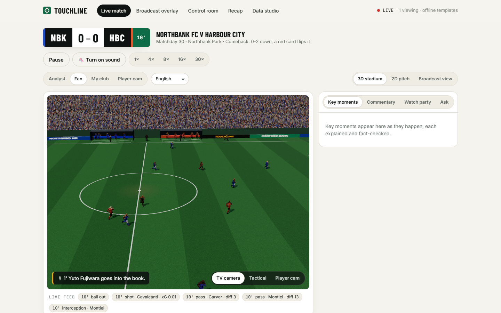
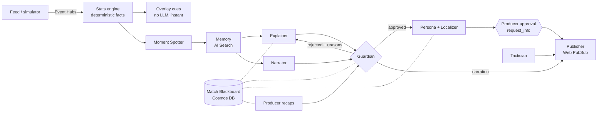
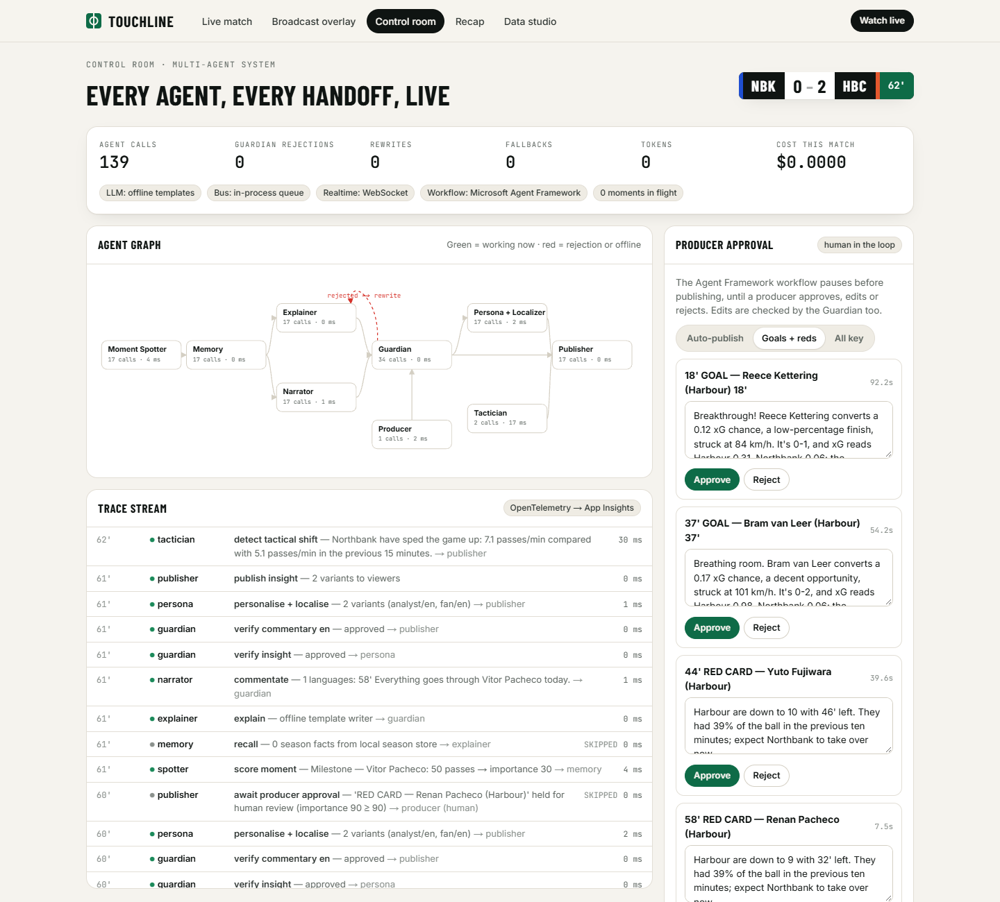

# Touchline

**Explainable, personalised match intelligence from synthetic football events.**
Touchline ingests a live event stream and computes every number deterministically. A team of AI agents built on **Microsoft Agent Framework** explains *why* each moment matters, renders broadcast-ready overlay cues, and personalises everything for every viewer in any language. Nothing reaches the screen until a Guardian agent has fact-checked it. Fans watch it in a living 3D stadium with commentary, crowd noise and a multiplayer watch party.

> Built for the **Inside the Game** developer hackathon. All clubs, players and data are synthetic and fictional.



| | |
|---|---|
| **Try it** | `/` landing · `/live?match=demo` match center · `/overlay?match=demo` broadcast overlay · `/control?match=demo` control room · `/recap?match=demo` · `/studio` |
| **Primary category** | Best Multi-Agent System. Also built for Best Use of Microsoft Foundry, Best Enterprise Solution and Best Azure Cloud Native Integration. |
| **Verified** | **29/29** unit and integration tests · **83/83** end-to-end checks ([report](docs/e2e/report.md)) · **1,920/1,920** published texts grounded · **5/5** data-realism checks ([eval](docs/eval/report.md)) |
| **Prize criteria → evidence** | [Section 2: how Touchline meets each prize](#2-how-touchline-meets-each-prize) · [CRITERIA.md](CRITERIA.md) |

---

## 1. Every challenge requirement, and where it is

Each item below names its code and the end-to-end check that proves it ([docs/e2e/report.md](docs/e2e/report.md)).

### (i) One pipeline, five stages
| Stage | What Touchline does | Code | E2E check |
|---|---|---|---|
| **(a) Ingest** | The live feed carries passes, carries, dribbles, shots, tackles, interceptions (possession changes), **pressure events**, fouls, cards, substitutions, set pieces and match metadata, plus 5 Hz tracking for 22 players and the ball. It flows through Azure Event Hubs, or an in-process bus when running locally. | `live/bus.py`, `live/session.py` | "events streamed live", "pressure events", "possession changes" |
| **(b) Interpret** | The stats engine computes xG, pass difficulty, distance and accuracy, ball and shot speed, player speed, sprints and distance, PPDA, field tilt, momentum and a **Control vs Chaos index**. Every number becomes a `Fact` with an id. | `stats/engine.py`, `stats/models.py` | "facts registered", "live stats snapshots" |
| **(c) Explain** | The Moment Spotter scores events 0–100. The Explainer says *why* a moment matters and cites fact ids. The Guardian verifies every number, name and sentence. | `intel/moments.py`, `agents/` | "Guardian caught injected wrong number", "insights cite facts" |
| **(d) Render** | Timed, machine-readable overlay cues (`/api/schema/overlay`) drive the broadcast graphics and the 3D stadium. | `intel/overlay.py`, `web/components/OverlayStage.tsx` | "overlay cue templates", "cues timed" |
| **(e) Personalise** | **Analyst, Fan, My Club and Player Cam** modes. Viewers choose a favourite club, a favourite player to follow, **"your metric"** (pin one stat you care about) and a **language**. Each viewer receives only their own variant. | `agents/specialists.Persona`, `web/components/PersonalizeBar.tsx`, `MetricPin.tsx` | "receives own variants" ×5, "player-focus mode" |

### (ii) Real-time match intelligence
| Feature | Implementation |
|---|---|
| **Player identification** | Real-time name tags: `player_tag` cues, plus 3D name tags on the ball carrier and the followed player. **Speed and distance badges** fire only when thresholds are crossed: sprint ≥ 32 km/h, or the first player to reach 5 km or 10 km. |
| **Pass quality** | Every pass carries distance, a **difficulty rating (0–100)** from a logistic model (distance, forward gain, pressure, opponents in the lane, pass type) and player accuracy. A "pass of the match" moment highlights the best one. |
| **Speed metrics** | **Ball speed** on every pass and **shot speed** on every shot, measured from the ball's flight path. |
| **Auto-eventing** | `autoevent.py` renders a synthetic tactical-camera video with noise and occlusions, then detects players and the ball **from pixels alone**. It derives passes and ball speed and scores them against the ground-truth feed. Result: 94–100% ball detection, about 19 of 22 players found per frame, ball speed within about 2 km/h, F1 about 0.6. Run it from the Data Studio. |

### (iii) Narrative generation
- **Narrator:** live commentary in each viewer's language, plus spoken play-by-play in the browser.
- **Producer:** half-time and full-time recaps, with Player of the Match and a stated reason.
- **Memory agent:** season milestones from a 380-match synthetic season, such as "now has 9 league goals this season".
- **Milestone moments:** passes and distance.

### (iv) Explainability
- **Control vs Chaos index:** combines turnover rate, duel rate and possession-chain length.
- **Pressure-shift detection:** compares PPDA across windows.
- **Momentum swings** from an expected-threat model.
- **Tactician agent:** 15-minute windows covering pressing, tempo and control.
- Every claim has **clickable citation chips** that show the fact and its source events.

### (v) Data innovation
- **The simulator:** a possession-chain model of 20 fictional clubs with distinct styles, player attributes, fatigue, pressure, momentum and home advantage, plus 5 Hz steering-physics tracking.
- **Scenario Director:** turns plain English ("a comeback with a red card at 60'") into a scripted match.
- **Season dataset:** 380 matches (`data/season/`) that pass 5 of 5 checks against top-flight norms.
- **Exports:** JSON for any match, plus a GitHub Release workflow for the full dataset.

### (vi) Multi-language storytelling
- Built-in, Guardian-safe output in **English, Spanish, French, Portuguese, Arabic** (right-to-left) and **Japanese**.
- Any other language through Foundry models or Azure AI Translator, with player and club names protected from translation.
- Spoken commentary uses the viewer's language.

---

## 2. How Touchline meets each prize

Every claim below links to code or to a test that runs in CI. "Measured" numbers come from the end-to-end run ([docs/e2e/report.md](docs/e2e/report.md)), which uses offline templates. Model latency adds to those numbers when Foundry is connected.

### Best Multi-Agent System
| What judges assess | Touchline |
|---|---|
| **Specialised agents with distinct roles** | 9 agents with single responsibilities and typed outputs: Moment Spotter, Memory, Explainer, Narrator, **Guardian**, Persona + Localizer, Tactician, Producer and Ask (A2A). See [section 4](#4-the-multi-agent-system). |
| **Coordination through shared state** | A Match **Blackboard** (Cosmos DB) holds facts, moments, insights, traces and the audit log. Every agent reads verified facts from it and never computes numbers itself. |
| **Effective handoffs** | A Microsoft Agent Framework workflow: fan-out from Memory to Explainer and Narrator, conditional edges from the Guardian (approved → Persona, rejected → Explainer with machine-readable reasons), and a `request_info` pause for a human producer. A2A exposes the analyst to other agents, and MCP exposes the match to **GitHub Copilot**, which has its own custom agent in this repo. |
| **Recovers from failures** | Timeouts, circuit breakers, verified fallbacks, a spend cap, and Guardian reject → rewrite. The Control Room's chaos test kills agents or injects a wrong number live. CI proves it: "Guardian caught injected wrong number", "Explainer rewrote after rejection", "killed agent fell back, feed kept flowing". |
| **Better than a single agent** | A single prompt has no independent check on its own numbers. Touchline's facts come from code, every sentence cites them, and a critic blocks anything else: **1,920/1,920** published texts were grounded. One canonical insight becomes 4 modes × N languages (**145 variants** in one match) with no extra generation per viewer. `foundry_ops evaluate` measures the gap against a single-agent baseline with Foundry evaluators. |

### Best Use of Microsoft Foundry
| What judges assess | Touchline |
|---|---|
| **Accelerates development** | Prompts live as files and are published to Foundry as **versioned prompt agents** in one command (`foundry_ops register`). A producer can change an agent's instructions or model in the portal and roll back, with no redeploy. |
| **Orchestration and management** | Agent Framework runs the agents (`FoundryChatClient` / `FoundryAgent`) in two model tiers. `enable_instrumentation()` sends agent and workflow spans to Foundry tracing via App Insights. The Control Room shows per-agent calls, latency, tokens and cost. |
| **Quality you can measure** | Foundry evaluators (groundedness, relevance, coherence, task adherence) plus Touchline's **Guardian as a custom evaluator**, comparing the multi-agent Explainer with a single-agent baseline. The custom evaluator is tested in CI (`test_guardian_as_foundry_evaluator`). |
| **Scalable AI experiences** | Infrastructure as code creates the Foundry account, project and model deployments (`infra/resources.bicep`). A per-match **spend cap** keeps cost bounded, and personalisation reuses one canonical insight per moment. |
| **Hard to do without it** | Hosted, versioned agents, built-in evaluators, tracing and model deployments in one project. Building that by hand would need a separate prompt registry, eval service and telemetry pipeline. |

### Best Enterprise Solution
| What judges assess | Touchline |
|---|---|
| **Reliability** | Every agent call has a timeout, circuit breaker and verified fallback. **Latency SLO** (moment → published insight) is tracked live: measured **p50 32 ms, p95 60 ms** offline. There are 29 unit tests and 83 end-to-end checks in CI on every push. |
| **Transparency** | Every sentence carries clickable citations to facts and their source events. The **audit trail** records every Guardian check, human decision and publication. The live trace stream exports to OpenTelemetry. |
| **Controls** | **Human-in-the-loop approval** through Agent Framework `request_info`, where human edits are also fact-checked. An **operator key** protects control actions. **Rate limits** apply to Ask and fan chat. A **spend cap** per match. Content Safety screens agent output and fan chat. |
| **Security** | Keyless: a user-assigned **managed identity** with RBAC for Event Hubs, Cosmos DB, Web PubSub, Content Safety, AI Search, Storage and Foundry. Local auth is disabled where the service allows it. Deploys use OIDC (no stored secrets). |
| **Path to adoption** | One-command `azd up`. Renderer-agnostic overlay JSON (`/api/schema/overlay`) for any graphics partner. A2A and MCP for integration with other agents and tools. Teams distribution through Logic Apps. Synthetic data only, no PII. |
| **Long-term impact** | One pipeline serves broadcast graphics, streaming apps and social recaps in any language, with production controls a newsroom needs. |

### Best Azure Cloud Native Integration
| What judges assess | Touchline |
|---|---|
| **Container Apps** | `app` (API + web, health probes) and `mcp` (scale to zero on HTTP), plus a **Container Apps Job** that regenerates the 380-match season. Images are pulled from ACR with managed identity. |
| **Functions** | A Flex Consumption app. An **Event Hubs trigger** archives every event to Cosmos DB and fires phase notifications. A **timer trigger** starts the season job. An HTTP probe. Bindings are tested in CI (`test_functions_app_bindings`). |
| **Logic Apps** | Recap and phase distribution to Microsoft Teams. |
| **Event-driven architecture** | Feed → **Event Hubs** (partitioned per match) → three independent consumers: the live intelligence pipeline, the Functions archive, and the Microsoft Fabric Eventstream. Results reach viewers through **Web PubSub** groups per personalisation key. |
| **AI-optimised data platforms** | Cosmos DB as the agent blackboard and event archive, AI Search for season memory, Fabric Eventhouse with KQL for match analytics. |
| **Automation and operational excellence** | Everything is in Bicep with `azd`. CI covers lint, tests, eval, the web build, Bicep and end-to-end. Deploys use OIDC, the season job runs on a schedule, and telemetry goes to App Insights. |
| **Measurable business impact** | 1 match → about 1,900 events, 249 timed overlay cues, 29 explained moments and 145 personalised variants in 6 languages, with zero unverified numbers. Spend is capped per match, and latency is reported live. |

## 3. How we use each Microsoft and Azure technology

The **Status** column is precise:
- **Verified** means it ran in our tests.
- **Wired** means the code path and infrastructure are written. It activates when the environment variable is set or after `azd up`, and we have not exercised it against a live Azure resource.

| Technology | How Touchline uses it | Where | Status |
|---|---|---|---|
| **Microsoft Agent Framework: workflows** | Each key moment runs a typed workflow graph. Memory **fans out** to Explainer and Narrator. The Guardian has **conditional edges**: approved → Persona, rejected → back to Explainer for a rewrite with machine-readable reasons, narration → Publisher. A fresh graph per moment means moments run concurrently. | `agents/workflow.py` | Verified |
| **Agent Framework: human-in-the-loop** | The Publisher calls **`request_info`** on high-importance moments. The workflow **pauses** until a producer approves, edits or rejects it in the Control Room, then resumes through a `@response_handler`. Human edits are re-verified by the Guardian. | `workflow.py` `PublisherExecutor`, `live/session.py decide()` | Verified |
| **Agent Framework: agents and tools** | The "Ask" analyst is an `Agent` with **function tools** over the live stats engine. Every number in its answer must come from a tool output. | `agents/ask.py` | Verified offline router · Wired model path |
| **Agent Framework: A2A** | The analyst is published as an **A2A agent**, using `A2AExecutor`, an Agent Card and JSON-RPC. We verified interoperability with Agent Framework's own `A2AAgent` client. | `a2a_server.py` (`/a2a/`) | Verified |
| **Agent Framework: observability** | `enable_instrumentation()` emits GenAI semantic-convention spans for agents, chat clients and workflows to App Insights and Foundry tracing. Our own per-agent spans carry tokens, latency and cost. | `telemetry.py`, `agents/runtime.py` | Wired |
| **Microsoft Foundry** | `FoundryChatClient` with Entra ID, in **two tiers**: a fast model (explain, narrate, personalise) and a reasoning model (tactics, recaps). **Managed agents**: `foundry_ops register` publishes every prompt as a versioned Foundry prompt agent, and `FOUNDRY_HOSTED_AGENTS=true` runs them through `FoundryAgent`, so prompts and models are tuned, versioned and rolled back in the Foundry portal without redeploying. **Evaluations**: `foundry_ops evaluate` scores a single-agent baseline and the Explainer with Foundry's groundedness, relevance, coherence and task-adherence evaluators, plus the Guardian as a custom evaluator. Results appear in the portal. **Spend control**: a per-match budget sends agents to verified templates once reached. `azd up` creates the account, the project and both model deployments. | `agents/llm.py`, `foundry_ops.py`, `infra/resources.bicep` | Guardian evaluator, budget and fallback Verified · portal runs Wired |
| **MCP** | `touchline-mcp` exposes 10 tools (match_state, key_moments, events, player, fact, ask, agent_status, generate_match, …) to GitHub Copilot, Claude or any MCP client. It runs over stdio or streamable HTTP as its own Container App. | `mcp_server.py`, `.vscode/mcp.json` | Verified |
| **Azure Event Hubs** | Live event ingest, partitioned per match. The consumer attaches before the feed starts so no event is lost. A `fabric` consumer group feeds analytics. | `live/bus.py` | Wired (local bus Verified) |
| **Azure Container Apps (+ Jobs)** | `app` (API + web), `mcp` (scales to zero), and a **Job** that regenerates the 380-match season on demand. Health probes, user-assigned managed identity, pulls from ACR without keys. | `infra/resources.bicep` | Wired (Bicep compiles Verified) |
| **Azure Cosmos DB** | The **Match Blackboard**, the shared state between agents. It doubles as the **audit trail** of every Guardian check, human review and published insight. Serverless, RBAC-only. | `agents/blackboard.py` | Wired (in-memory Verified) |
| **Azure Web PubSub** | Realtime fan-out with a group per match and per personalisation key, so each viewer only receives their own variant. | `live/hub.py` | Wired (WebSocket Verified) |
| **Azure AI Content Safety** | Screens every published sentence and every watch-party chat message. A local block list always applies too. | `azure_services.py`, `live/party.py` | Wired (local screen Verified) |
| **Azure AI Translator** | Any-language localisation. Player and club names are wrapped in `notranslate` so they are never translated. | `azure_services.py`, `Persona` | Wired |
| **Azure AI Search** | Season memory: one document per player per matchday, so the Memory agent can answer "league goals before kick-off" with a single key lookup. | `search_index.py`, `MemoryAgent` | Wired (local store Verified) |
| **Azure Functions** | Flex Consumption app with three functions. An **Event Hubs trigger** (its own consumer group) archives every match event to a Cosmos DB `events` container and notifies the Logic App at half time and full time. A **timer trigger** starts the season-regeneration Container Apps Job nightly. An **HTTP** health probe. All bindings are keyless (managed identity). | `functions/`, `infra/resources.bicep` | Bindings Verified · cloud run Wired |
| **Azure Logic Apps** | Distributes the full-time recap and phase notifications, for example to a Microsoft Teams channel. | `infra/resources.bicep`, `session._distribute`, `functions/` | Wired |
| **Microsoft Fabric** | Eventstream (Event Hubs, `fabric` group) → Eventhouse. The KQL queryset covers pass completion, pressing maps, a shot-speed leaderboard and turnover rate. | `infra/fabric/queries.kql` | Wired |
| **Application Insights / Azure Monitor** | OpenTelemetry for agents, workflows and the API. The Control Room shows the same data live: calls, latency, tokens, cost, rejections and fallbacks. | `telemetry.py` | Wired (Control Room Verified) |
| **Microsoft Entra ID** | Keyless managed identity for every Azure service. **Sign in with Microsoft** (MSAL) for the watch party. | `infra/`, `web/components/WatchParty.tsx` | Wired (needs an app registration id) |
| **GitHub Copilot / Actions / CLI** | A **Copilot custom agent** (`.github/agents/touchline-analyst.agent.md`) that works alongside the live agents over MCP. Also `.github/copilot-instructions.md`, a reusable prompt file and an MCP config for Copilot agent mode. The CI workflow runs lint, tests, eval, the web build and a Bicep build. Deploy uses OIDC (no secrets). A dataset release workflow publishes the season with `gh release`. | `.github/` | Verified files · Wired runs on push |

---

## 4. The multi-agent system



| Agent | Job | Fallback |
|---|---|---|
| Moment Spotter | Scores events 0–100 with transparent rules | n/a |
| Memory | Season context (league goals, table, form) | Local season store |
| Explainer | Says why it matters and cites `fact_id`s | Verified template |
| Narrator | Commentary in every viewer language | Verified template |
| **Guardian** | Numbers traced to cited facts, only names from this match, Content Safety, length budget | Blocks publication |
| Persona + Localizer | Analyst, Fan, Club and Player modes × any language | Verified template |
| Tactician | Pressing, tempo and control shifts | Template |
| Producer | Recaps and Player of the Match | Template |
| Ask (A2A) | Tool-calling Q&A | Intent router |

**Reliability you can watch.** Every call has:
- a timeout,
- a circuit breaker,
- a verified fallback,
- a trace.

The Control Room's **chaos test** can take an agent offline or make the Explainer write a wrong number. The E2E test does both: the Guardian rejects the wrong number, the Explainer rewrites it, the offline agent falls back, and the feed keeps flowing.



## 5. The fan experience

- **3D stadium.** Animated human players in kits are driven by the tracking feed and kick the ball with a real leg swing.
  - The ball rolls on short passes, arcs on long balls, crosses and clearances, and stays at the dribbler's feet.
  - Around the pitch: a referee and assistants who follow play, managers in their technical areas, dugouts with substitutes, warm-up players, sponsor LED boards (fictional brands), floodlights and a crowd that bounces on goals.
  - Three cameras: TV, tactical and player cam.
- **Sound.** Spoken commentary is emotional for goals, equalisers and comebacks, and deflated when the home side concedes. Synthesised crowd voices react from the home fans' point of view with roars, groans, "oooh"s, boos, applause and clapping chants. The referee's whistle sounds for fouls, kick-offs, half time and full time. All audio is generated, so there are no third-party recordings.
- **Watch party (multiplayer).** Fans sign in with Microsoft or as a guest, chat (safety-screened), throw emoji reactions into the stadium, and predict who scores next. Live goals settle each round and update the leaderboard.

## 6. Run it

```bash
python -m venv .venv && .venv/Scripts/pip install -e "./backend[dev]"
cd web && pnpm install && pnpm build && cd ..
cd backend && ../.venv/Scripts/python -m touchline.cli serve        # http://localhost:8000 (offline, no keys)
```
- **Foundry:** set `FOUNDRY_PROJECT_ENDPOINT`, `FOUNDRY_MODEL_FAST` and `FOUNDRY_MODEL_REASONING`, then run `az login`.
- **Azure:** `azd up`. See [SETUP.md](SETUP.md).
- **Microsoft sign-in:** set `NEXT_PUBLIC_ENTRA_CLIENT_ID` to your Entra app registration id before `pnpm build`.

**Tests**
```bash
cd backend
../.venv/Scripts/python -m pytest -q                 # 29 unit + integration tests
../.venv/Scripts/python tests/e2e/run_e2e.py         # 83 end-to-end checks on a fresh server → docs/e2e/report.md
../.venv/Scripts/python -m touchline.cli eval        # realism + grounding (+ single vs multi-agent with a model)
```

## 7. Repository

```
touchline/
├── backend/
│   ├── pyproject.toml
│   ├── touchline/
│   │   ├── sim/              simulator, tracking physics, fictional league, scenarios
│   │   ├── stats/            stats engine, xG / pass-difficulty / threat models
│   │   ├── intel/            moment detection, overlay cues, offline analysis
│   │   ├── agents/           Agent Framework workflow, specialists, Guardian, templates, ask
│   │   │   └── prompts/      versioned prompts for each agent
│   │   ├── live/             session orchestration, Event Hubs bus, Web PubSub hub, watch party
│   │   ├── api/              FastAPI: REST, WebSocket, A2A mount, static web
│   │   ├── autoevent.py      auto-eventing from synthetic video
│   │   ├── mcp_server.py     MCP server for Copilot and other clients
│   │   ├── a2a_server.py     A2A agent card and endpoint
│   │   ├── season.py         380-match season generator and memory
│   │   ├── evals.py          realism, grounding, single vs multi-agent
│   │   ├── foundry_ops.py    Foundry managed agents and evaluations
│   │   └── telemetry.py      OpenTelemetry and Agent Framework instrumentation
│   └── tests/
│       ├── test_*.py         unit and integration tests
│       └── e2e/run_e2e.py    end-to-end suite (83 checks)
├── web/
│   ├── app/                  landing, live, overlay, control, recap, studio pages
│   ├── components/           3D stadium, overlay renderer, feeds, watch party
│   ├── lib/                  API client, live match hook, audio engine, types
│   └── public/models/        animated 3D player model
├── functions/                Azure Functions: event archive, phase alerts, nightly season job
├── infra/
│   ├── main.bicep            subscription entry point for azd
│   ├── resources.bicep       every Azure resource, keyless
│   └── fabric/queries.kql    Fabric Real-Time Intelligence queries
├── data/season/              380-match synthetic season
├── docs/
│   ├── e2e/report.md         end-to-end report
│   ├── eval/report.md        evaluation report
│   └── images/               screenshots
├── .github/
│   ├── workflows/            ci, deploy, dataset-release
│   ├── agents/               GitHub Copilot custom agent
│   ├── prompts/              Copilot prompt files
│   └── copilot-instructions.md
├── Dockerfile
└── azure.yaml
```

## 8. Responsible AI
- **Synthetic, fictional data only.** No real footage, clubs, players or league marks. Sponsors are Microsoft's fictional sample brands.
- **Models never produce numbers.** The Guardian blocks any figure that is not traced to a verified fact, and that applies to human edits too.
- **Human in the loop.** Producers can require sign-off on high-stakes moments.
- **Full audit trail.** Every check, decision and publication is recorded.
- **Content Safety** screens agent output and fan chat.

**Credits:** the 3D player model and its animations are the Three.js example "Soldier" character (Mixamo), recoloured in code into football kits.
